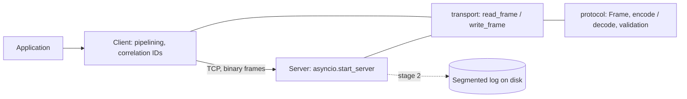
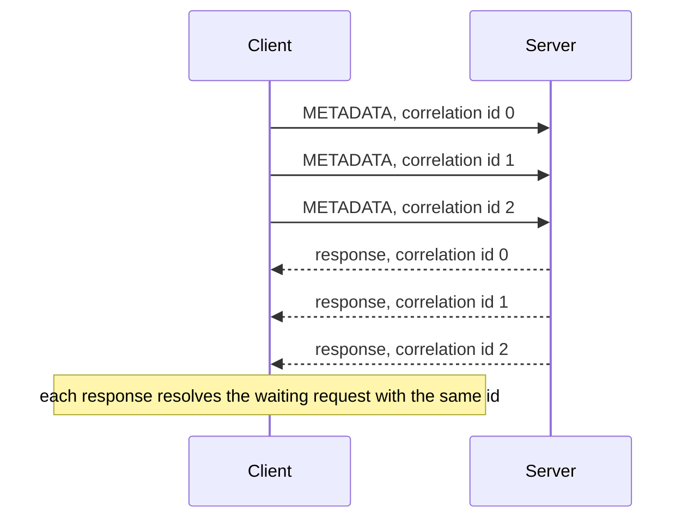

# PyQueue

[](https://github.com/EvilTheron/pyqueue/actions/workflows/ci.yml)

A Kafka-inspired message broker written from scratch in Python on asyncio. The goal is to implement the core mechanics of a log-based broker without relying on existing broker or serialisation libraries: a custom binary protocol over TCP, an append-only segmented log on disk, consumer offsets and, later, replication.

## Status

The project is being built in stages. Only completed stages are described as features below.

| Stage | Scope | Status |
|---|---|---|
| 1 | Binary protocol, asyncio TCP server and client | Done |
| 2 | Storage: log segments, sparse index, CRC32, retention | In progress |
| 3 | Single node: topics and partitions, produce, fetch, offset commits, idempotent producer, crash recovery | Planned |
| 4 | Replication with quorum acknowledgements | Planned |
| 5 | Raft leader election and chaos testing | Planned |

At the moment the server accepts and validates frames and echoes them back; request handling arrives together with the storage layer.

## Features

- Length-prefixed binary frame protocol with request types and correlation IDs.
- Frame size limit enforced before the body is read, so a peer cannot force a large allocation by sending a fake length.
- Malformed, truncated or oversized frames close only the offending connection; the server keeps serving other clients.
- Asyncio client with request pipelining: many requests share one connection, and responses are matched to requests by correlation ID.
- Fail-fast client: when the connection drops, every pending request fails immediately instead of waiting for its timeout.
- No runtime dependencies; standard library only.
- CI on Linux and Windows: lint, formatting, strict type checks and tests with a coverage threshold.

## Architecture



The code is split into three layers:

- `protocol.py` knows only bytes: the frame layout, encoding, decoding and validation. It has no I/O and is tested in isolation.
- `transport.py` reads and writes whole frames on asyncio streams. It is shared by the server and the client.
- `server.py` and `client.py` implement connection handling on top of the transport.

## Wire protocol

Every message is a frame. All integers are big-endian.

```text
+----------------+--------------+------------------------+----------+
| length: uint32 | type: uint16 | correlation id: uint32 | body     |
+----------------+--------------+------------------------+----------+
     4 bytes          2 bytes            4 bytes          variable
```

- `length` counts every byte after itself: type, correlation ID and body. TCP is a byte stream, so the length prefix is what separates one message from the next.
- `type` is the request type. A response carries the same type as its request.
- `correlation id` is chosen by the client and copied into the response, which lets the client send several requests without waiting and still match the answers.
- The maximum frame size is 1 MiB. A frame shorter than the header or longer than the limit is rejected as soon as the length prefix is read.

| Type | Code | Purpose |
|---|---|---|
| `PRODUCE` | 0 | Append records to a partition |
| `FETCH` | 1 | Read records starting at an offset |
| `COMMIT_OFFSET` | 2 | Store a consumer group offset |
| `FETCH_OFFSET` | 3 | Read a committed offset |
| `METADATA` | 4 | Describe topics and partitions |

Request and response bodies are not defined yet; they will be specified together with the storage layer.

### Pipelining



The client keeps a map of correlation ID to pending future. A background task reads responses and resolves the matching future; a response with an unknown ID is logged and dropped. Writes are serialised with a lock so that frames from concurrent requests never interleave on the wire.

## Design decisions and trade-offs

- **Custom protocol instead of HTTP or gRPC.** A broker is a long-lived, high-throughput connection with many small messages; a minimal binary frame keeps overhead low and makes the parsing logic explicit. The layout is close to Kafka's request header.
- **asyncio streams instead of threads.** One process can hold many idle connections cheaply, which fits a broker's workload.
- **Length validated before the body is read.** Decoding is split into `decode_length` and `decode_payload`, so the server rejects a bad length without reading or buffering the body.
- **One bad client cannot take the server down.** Protocol errors and unexpected exceptions are handled per connection: the connection is closed and logged, other connections are unaffected.
- **Responses use the request type.** There is no separate response type field; the correlation ID already identifies the request.
- **No protocol version in the header.** Kafka carries an `api_version` field per request. It is deliberately omitted to keep the format simple; adding it later is a breaking change.

## Getting started

Requirements: Python 3.14 and [uv](https://docs.astral.sh/uv/).

```bash
git clone https://github.com/EvilTheron/pyqueue.git
cd pyqueue
uv sync
```

Start the server (listens on `127.0.0.1:9092`):

```bash
uv run python -m pyqueue
```

In another terminal, send three concurrent requests over one connection:

```bash
uv run python scripts/ping.py
```

Using the client from code:

```python
import asyncio

from pyqueue.client import Client
from pyqueue.protocol import RequestType


async def main() -> None:
    async with Client("127.0.0.1", 9092) as client:
        response = await client.request(RequestType.METADATA, b"hello")
        print(response)


asyncio.run(main())
```

## Testing and quality

```bash
uv run ruff check .
uv run ruff format --check .
uv run mypy            # strict mode
uv run pytest --cov=pyqueue
```

The test suite starts a real server on a random port and covers valid traffic, including two frames arriving in one TCP write and a frame arriving one byte at a time, as well as failure paths: truncated and oversized frames, unknown request types, connections dropped mid-frame, errors inside the request handler, unexpected responses and requests on a broken connection. Coverage is about 99%; CI enforces a minimum of 90% and runs every check on Ubuntu and Windows.

## Project layout

```text
src/pyqueue/
├── __main__.py    # entry point: python -m pyqueue
├── protocol.py    # frame format, encoding, decoding, validation
├── transport.py   # read_frame / write_frame on asyncio streams
├── server.py      # TCP server
└── client.py      # pipelining client
scripts/
└── ping.py        # manual check against a running server
tests/             # pytest suite
```

## Limitations

- The server only echoes frames; there is no storage or request handling yet.
- No read or idle timeout on the server: a client can hold a connection open indefinitely or send a frame very slowly.
- Requests on one connection are processed sequentially. This is fine for echo and will be revisited once disk operations are added.
- No protocol versioning, authentication or TLS.
- Host and port are fixed in code; configuration via environment variables will be added with the Docker setup.
