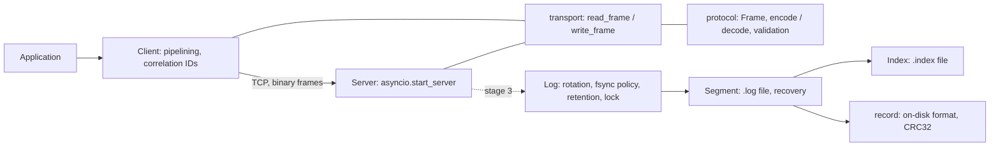
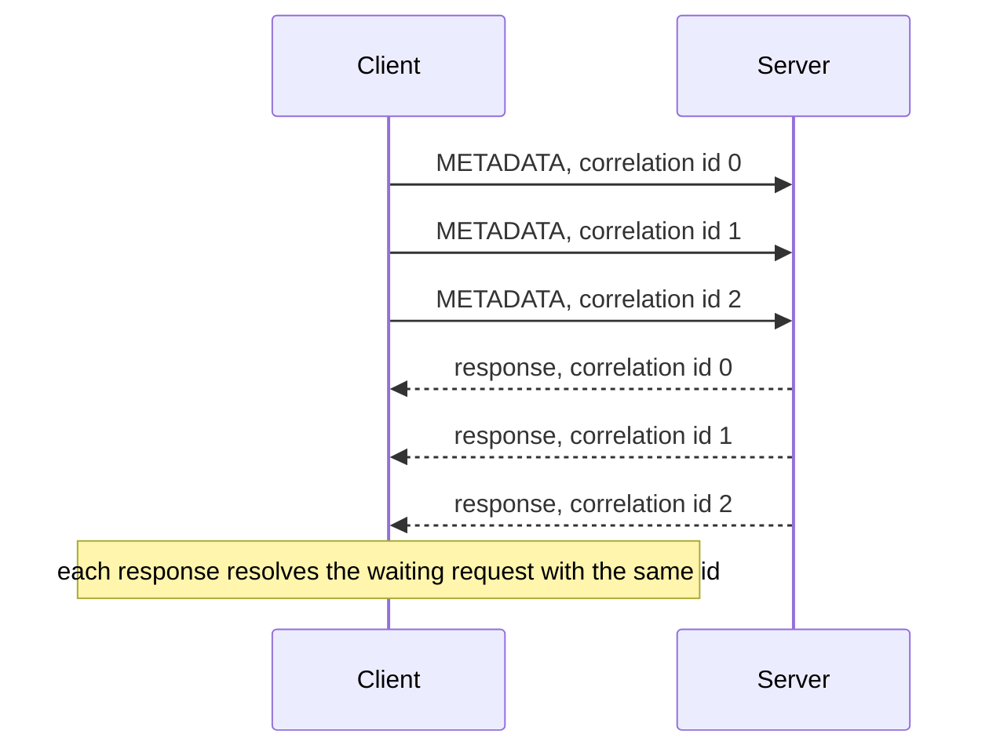
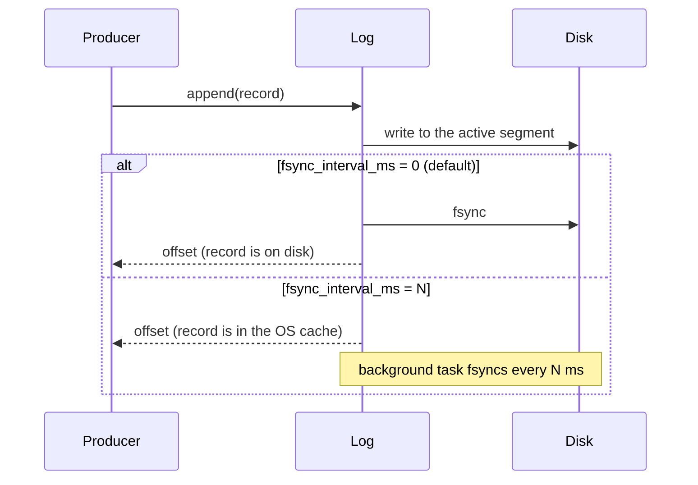
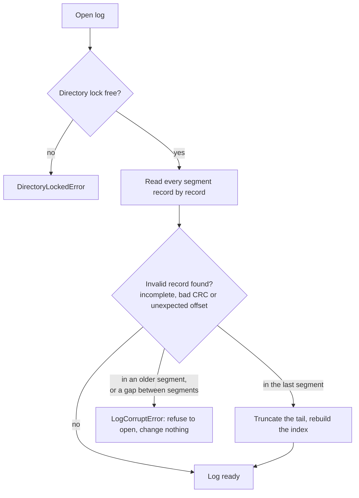

# PyQueue

[](https://github.com/EvilTheron/pyqueue/actions/workflows/ci.yml)

A Kafka-inspired message broker written from scratch in Python on asyncio. The goal is to implement the core mechanics of a log-based broker without relying on existing broker or serialisation libraries: a custom binary protocol over TCP, an append-only segmented log on disk, consumer offsets and, later, replication.

## Status

The project is being built in stages. Only completed stages are described as features below.

| Stage | Scope | Status |
|---|---|---|
| 1 | Binary protocol, asyncio TCP server and client | Done |
| 2 | Storage: log segments, sparse index, CRC32, crash recovery, retention | Done |
| 3 | Single node: topics and partitions, produce, fetch, offset commits, idempotent producer | Planned |
| 4 | Replication with quorum acknowledgements | Planned |
| 5 | Raft leader election and chaos testing | Planned |

The network layer and the storage layer are both complete but not yet connected: the server still echoes frames, and the log is used directly from Python. Stage 3 wires them together.

## Features

**Network**

- Length-prefixed binary frame protocol with request types and correlation IDs.
- Frame size limit enforced before the body is read, so a peer cannot force a large allocation by sending a fake length.
- Malformed, truncated or oversized frames close only the offending connection; the server keeps serving other clients.
- Asyncio client with request pipelining: many requests share one connection, and responses are matched to requests by correlation ID.
- Fail-fast client: when the connection drops, every pending request fails immediately instead of waiting for its timeout.

**Storage**

- Append-only log split into segment files, rotated by size.
- Every record carries a CRC32 checksum; a sparse offset index finds a record without scanning the segment.
- Crash recovery: a half-written tail left by a crash is detected and truncated on startup. Damage anywhere else stops the log from opening instead of silently dropping data.
- Configurable durability: fsync on every append (default) or periodically in the background.
- Retention by total size and by record age.
- An exclusive directory lock prevents two processes from writing the same log.
- A crash test that kills the writing process at random moments and verifies that no acknowledged record is lost.

**Engineering**

- No runtime dependencies; standard library only.
- CI on Linux and Windows: lint, formatting, strict type checks and tests with a coverage threshold.

## Architecture



Each module has one job, and the lower layers know nothing about the upper ones:

- `protocol.py` and `record.py` only convert between objects and bytes (wire frames and on-disk records). They do no I/O and are tested in isolation.
- `transport.py` reads and writes whole frames on asyncio streams; `server.py` and `client.py` handle connections on top of it.
- `segment.py` and `index.py` manage one segment file and its index; `log.py` manages the sequence of segments, durability and retention; `lock.py` guards the directory.

## Wire protocol

Every message is a frame. All integers are big-endian.

```text
+----------------+--------------+------------------------+----------+
| length: uint32 | type: uint16 | correlation id: uint32 | body     |
+----------------+--------------+------------------------+----------+
     4 bytes          2 bytes            4 bytes          variable
```

- `length` counts every byte after itself: type, correlation ID and body. TCP is a byte stream, so the length prefix is what separates one message from the next.
- `type` is the request type. A response carries the same type as its request.
- `correlation id` is chosen by the client and copied into the response, which lets the client send several requests without waiting and still match the answers.
- The maximum frame size is 1 MiB. A frame shorter than the header or longer than the limit is rejected as soon as the length prefix is read.

| Type | Code | Purpose |
|---|---|---|
| `PRODUCE` | 0 | Append records to a partition |
| `FETCH` | 1 | Read records starting at an offset |
| `COMMIT_OFFSET` | 2 | Store a consumer group offset |
| `FETCH_OFFSET` | 3 | Read a committed offset |
| `METADATA` | 4 | Describe topics and partitions |

Request and response bodies are not defined yet; they will be specified in stage 3, when the server starts using the log.

### Pipelining



The client keeps a map of correlation ID to pending future. A background task reads responses and resolves the matching future; a response with an unknown ID is logged and dropped. Writes are serialised with a lock so that frames from concurrent requests never interleave on the wire.

## Storage

A log lives in one directory. Segment files are named after the offset of their first record, so listing the directory in name order lists them in offset order:

```text
data/partition-0/
├── .lock                          # directory lock
├── 00000000000000000000.log       # records 0 .. 4095
├── 00000000000000000000.index
├── 00000000000000004096.log       # active segment: new records go here
└── 00000000000000004096.index
```

### Record format

```text
+----------------+---------------+----------------+---------------------+
| length: uint32 | crc32: uint32 | offset: uint64 | timestamp_ms: int64 |
+----------------+---------------+----------------+---------------------+
| key_len: int32 | key           | value                                |
+----------------+---------------+--------------------------------------+
```

`length` lets a reader step from record to record. `crc32` covers every byte after itself, so a torn or corrupted record is detected. `key_len` is -1 when the record has no key. Records are limited to 1 MiB, and the length is checked before anything is read or allocated.

### Sparse index

Roughly every 4 KiB of log data, the index stores one 8-byte entry: the record offset relative to the segment start and its byte position in the file. A lookup binary-searches the index for the closest entry at or before the wanted offset and reads forward from there. The index is rebuilt from the records whenever a segment is opened, so a stale or damaged index file is never trusted, and it does not need its own fsync on every append.

### Durability



With the default policy a returned offset means the record survives a crash of the process or of the machine. The periodic policy trades that guarantee for throughput: a machine crash can lose up to N ms of acknowledged records.

If a write or an fsync fails, the log stops accepting writes until it is reopened. After a failed fsync the operating system may already have dropped the unwritten data, so a retried fsync could report success for data that is gone. Reopening re-reads the files and repairs them.

### Crash recovery

The design relies on one invariant: **a segment is fully synced before the next one is created**, whatever the fsync policy. After a crash, only the last segment can end with a half-written record.



A damaged older segment cannot be the result of an interrupted write, because it was synced before the crash. It means a disk or operator problem, so the log refuses to start and leaves the files untouched rather than discarding data.

### Retention

Whole segments are deleted from the start of the log, oldest first, so offsets never get a gap. The active segment is never deleted.

- **By size** (`retention_bytes`): the oldest segment is deleted only if the log without it is still at least the limit.
- **By time** (`retention_ms`): a segment is deleted when its *newest* record is older than the limit.

A deleted segment is removed from memory first, then closed (Windows cannot delete open files), then deleted from disk. If deletion fails halfway, the files left behind still form a valid log.

### Directory lock

Before reading any segment, the log takes an exclusive lock on a `.lock` file in the directory: `fcntl.flock` on Linux, `msvcrt.locking` on Windows. A second log on the same directory, in the same or another process, fails immediately. The operating system releases the lock when the process exits, even if it is killed, so a crash never leaves a stale lock.

### Using the log

```python
from pathlib import Path

from pyqueue.log import Log, LogConfig

config = LogConfig(segment_bytes=16 * 1024 * 1024, retention_bytes=1024**3)

with Log(Path("data/partition-0"), config) as log:
    offset = log.append(b"hello", key=b"user-1")
    for record in log.read(offset):
        print(record.offset, record.key, record.value)
    log.apply_retention()
```

| Setting | Default | Meaning |
|---|---|---|
| `segment_bytes` | 64 MiB | Size at which a new segment starts |
| `index_interval_bytes` | 4 KiB | Log bytes between two index entries |
| `fsync_interval_ms` | `0` | `0`: fsync every append; `N`: fsync every N ms via `run_periodic_sync` |
| `retention_bytes` | none | Keep at least this many bytes, delete older segments |
| `retention_ms` | none | Delete segments whose newest record is older than this |

## Design decisions and trade-offs

- **Custom protocol instead of HTTP or gRPC.** A broker is a long-lived, high-throughput connection with many small messages; a minimal binary frame keeps overhead low and makes the parsing logic explicit. The layout is close to Kafka's request header.
- **asyncio streams instead of threads.** One process can hold many idle connections cheaply, which fits a broker's workload.
- **Length validated before the body is read**, for both frames and records, so a corrupt or malicious length cannot trigger a huge read or allocation.
- **One bad client cannot take the server down.** Protocol errors and unexpected exceptions are handled per connection.
- **Checksum and offset are both verified on recovery.** A CRC catches damaged bytes but not a whole, valid record that does not belong at that position, so the expected offset is checked as well.
- **Repair only where a crash can explain the damage.** Truncating the last segment is safe; truncating an older one would hide a disk problem and lose acknowledged data.
- **The index is derived data.** Rebuilding it on open costs a scan of each segment at startup but removes a whole class of index corruption bugs and halves the fsync cost per append.
- **A failed fsync is fatal for the log instance**, following the lesson from PostgreSQL's "fsyncgate": retrying is not safe.
- **No protocol version in the header.** Kafka carries an `api_version` field per request. It is deliberately omitted to keep the format simple; adding it later is a breaking change.

## Getting started

Requirements: Python 3.14 and [uv](https://docs.astral.sh/uv/).

```bash
git clone https://github.com/EvilTheron/pyqueue.git
cd pyqueue
uv sync
```

Start the server (listens on `127.0.0.1:9092`):

```bash
uv run python -m pyqueue
```

In another terminal, send three concurrent requests over one connection:

```bash
uv run python scripts/ping.py
```

Using the client from code:

```python
import asyncio

from pyqueue.client import Client
from pyqueue.protocol import RequestType


async def main() -> None:
    async with Client("127.0.0.1", 9092) as client:
        response = await client.request(RequestType.METADATA, b"hello")
        print(response)


asyncio.run(main())
```

## Testing and quality

```bash
uv run ruff check .
uv run ruff format --check .
uv run mypy            # strict mode
uv run pytest --cov=pyqueue
```

The network tests start a real server on a random port and cover valid traffic, including two frames arriving in one TCP write and a frame arriving one byte at a time, as well as truncated and oversized frames, connections dropped mid-frame and errors inside the request handler.

The storage tests cut records at every byte and flip every byte to check that damage is always detected, damage segment files on disk and reopen them, inject failing fsyncs, writes and deletions, and lock the directory from a separate process that is then killed. Coverage is about 99%; CI enforces a minimum of 90% and runs every check on Ubuntu and Windows.

### Crash test

```bash
uv run python scripts/crash_test.py --rounds 20
```

Each round starts a process that appends records and reports every acknowledged offset, kills it at a random moment (SIGKILL on Linux, TerminateProcess on Windows), reopens the log and checks that every acknowledged record is present and intact. Small segments make the crashes hit rotations as well. It passes on Linux and Windows.

What it does and does not prove: it simulates a crash of the **process**. After a process crash the operating system still holds data that was not synced, so this test would pass with any fsync policy. Surviving a **power loss** is what fsync is for, and that cannot be verified by killing a process.

## Project layout

```text
src/pyqueue/
├── __main__.py    # entry point: python -m pyqueue
├── protocol.py    # frame format, encoding, decoding, validation
├── transport.py   # read_frame / write_frame on asyncio streams
├── server.py      # TCP server
├── client.py      # pipelining client
├── record.py      # on-disk record format, CRC32
├── index.py       # sparse offset index
├── segment.py     # one segment file: append, read, recovery
├── log.py         # segments, rotation, fsync policy, retention
└── lock.py        # exclusive directory lock
scripts/
├── ping.py        # manual check against a running server
└── crash_test.py  # kill the writer, verify acknowledged records
tests/             # pytest suite
```

## Limitations

- The server only echoes frames; it does not use the log yet (stage 3).
- File operations are blocking. Once the log is used by the server they will block the event loop; moving them to a worker thread is planned for stage 3.
- On startup every segment is scanned. With many large segments this slows startup; Kafka scans only the active segment after a clean shutdown.
- Corruption in the middle of the last segment cannot be told apart from a torn write, so everything after it is truncated. Kafka behaves the same way.
- Durability across power loss relies on fsync and is not covered by the crash test.
- Directory locks may not work on network file systems (NFS, SMB); keep data on a local disk.
- No read or idle timeout on the server: a client can hold a connection open indefinitely or send a frame very slowly.
- No protocol versioning, authentication or TLS.
- Host and port are fixed in code; configuration via environment variables will be added with the Docker setup.
